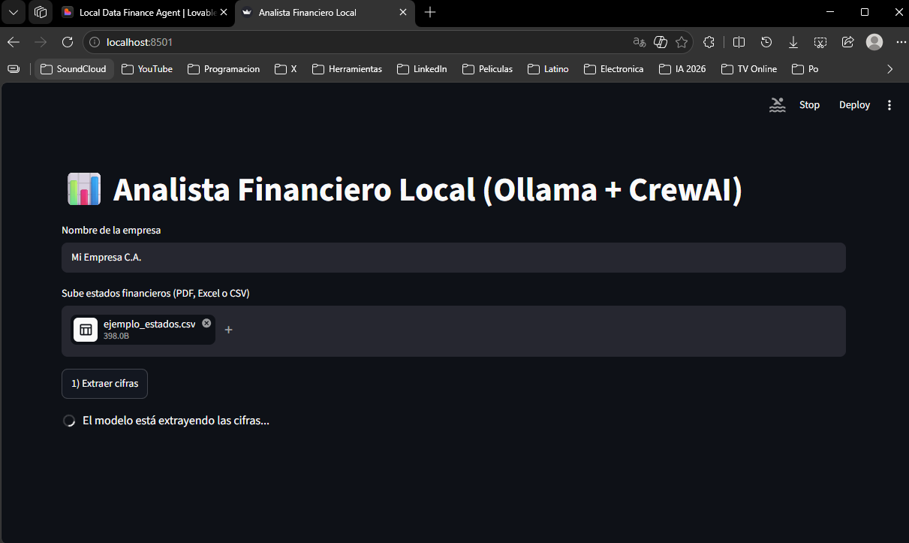
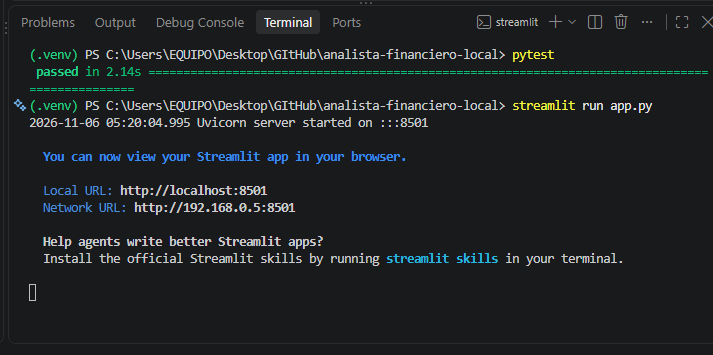
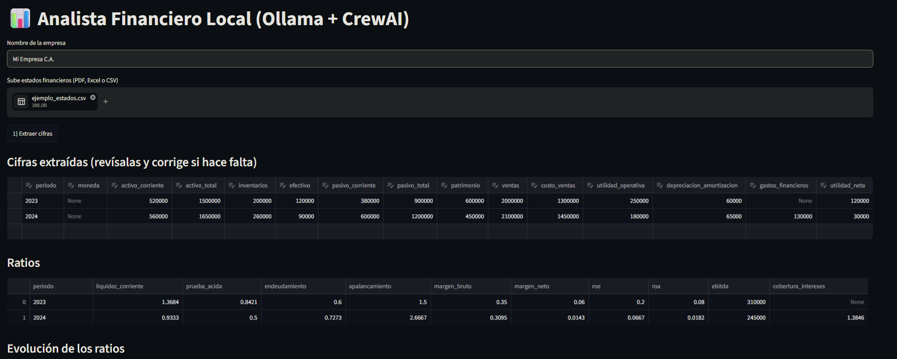
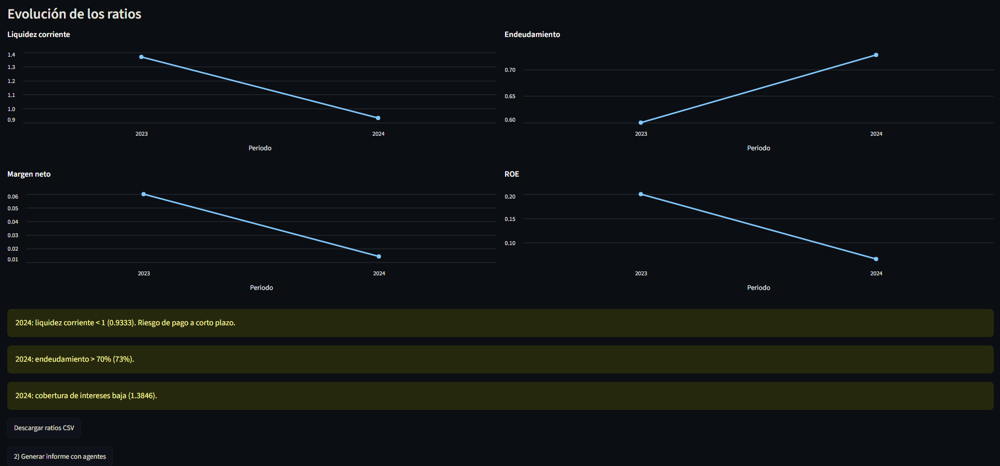
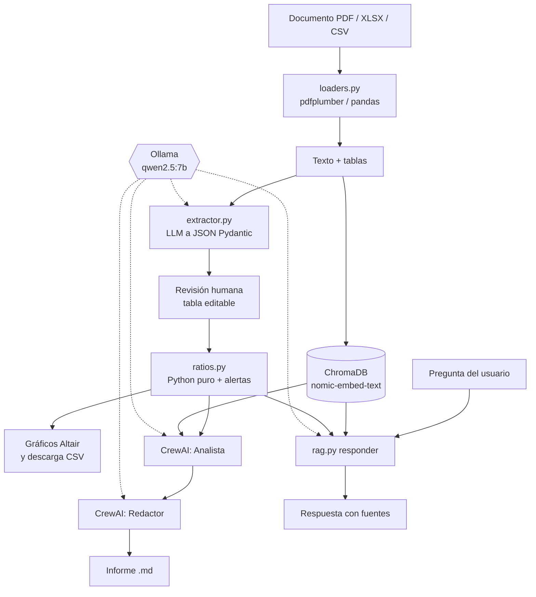

# Analista Financiero Local

Agente de IA **100 % local** que lee estados financieros (PDF, Excel o CSV), extrae las cifras,
calcula los ratios en Python y redacta un informe con agentes CrewAI.
Diseñado para correr en un equipo con **16 GB de RAM y sin GPU**.


---

## Pantallas

**1) Subes el documento y el modelo extrae las cifras**



**2) Pruebas y arranque desde la terminal de VS Code**



**3) Cifras extraídas en tabla editable y ratios calculados en Python**



**4) Evolución de los ratios, alertas y descarga del CSV**



---

## Por qué este proyecto

La mayoría de los agentes Text-to-SQL se quedan en "pregunta → consulta → tabla".
Aquí el reto es otro: el dato llega **desordenado en un documento**, hay que interpretarlo,
verificarlo antes de confiar en él, calcular con reglas deterministas y explicar el resultado.

La regla de diseño que sostiene todo el proyecto:

> **El LLM extrae e interpreta. Python calcula.**

El modelo nunca hace una división ni inventa un ratio: entrega un JSON validado con Pydantic,
tú corriges la tabla en pantalla, y `ratios.py` hace la aritmética.

## Qué hace

1. **Lee** el documento: PDF con `pdfplumber`, Excel/CSV con `pandas`.
2. **Indexa** el texto en Chroma (RAG local con `nomic-embed-text`), reemplazando el documento anterior.
3. **Extrae** las cifras a JSON validado con Pydantic (`qwen2.5:7b` vía Ollama).
4. **Tú revisas**: los números aparecen en una tabla editable antes de calcular nada.
5. **Calcula** 10 ratios y lanza alertas con reglas de negocio explicables.
6. **Redacta**: dos agentes CrewAI (Analista con herramienta RAG → Redactor) escriben el informe.
7. **Responde** preguntas sobre el documento con citas de la fuente original.

## Ratios incluidos

Liquidez corriente, prueba ácida, endeudamiento, apalancamiento, margen bruto, margen neto,
ROE, ROA, EBITDA y cobertura de intereses.

**Alertas:** liquidez corriente < 1, endeudamiento > 70 %, cobertura de intereses < 1,5 y pérdida neta.

## Arquitectura



## Requisitos

| Requisito | Detalle |
| --- | --- |
| Python | 3.11 o superior |
| RAM | 16 GB (con 8 GB usa `LLM_MODEL=qwen2.5:3b`) |
| GPU | No necesaria: CPU con modelos cuantizados |
| Ollama | Instalado y corriendo en segundo plano |

## Instalación

```bash
# 1. Modelos locales (una sola vez)
ollama pull qwen2.5:7b
ollama pull nomic-embed-text

# 2. Entorno Python
python -m venv .venv
source .venv/bin/activate        # Windows: .venv\Scripts\activate
pip install -r requirements.txt

# 3. Configuración
cp .env.example .env

# 4. Pruebas y arranque
pytest
streamlit run app.py
```

La app abre en `http://localhost:8501`.

## Ejecutar con Docker

Opción para quien no quiera instalar Python ni Ollama: Docker levanta **Ollama + la app** y descarga los modelos automáticamente la primera vez.

**Requisitos:** [Docker Desktop](https://www.docker.com/products/docker-desktop/) (Windows/macOS) o Docker Engine + Compose (Linux). En Docker Desktop asigna **al menos 10-12 GB de RAM** (Settings → Resources).

```bash
git clone https://github.com/darwinjcn/analista-financiero-local.git
cd analista-financiero-local
docker compose up -d --build
```

La primera vez descarga ~5 GB de modelos (`ollama-init`); puedes seguir el progreso con:

```bash
docker compose logs -f ollama-init
```

Cuando termine, abre **http://localhost:8501**.

| Comando | Para qué |
| --- | --- |
| `docker compose logs -f app` | Ver lo que hacen los agentes |
| `docker compose down` | Detener (los modelos se conservan) |
| `docker compose down -v` | Detener y borrar modelos e índice RAG |
| `LLM_MODEL=qwen2.5:3b docker compose up -d` | Usar un modelo más liviano (equipos de 8 GB) |

**¿Ya tienes Ollama instalado en tu equipo?** Puedes construir solo la app y apuntarla a tu Ollama local:

```bash
docker build -t analista-financiero .
docker run -p 8501:8501 -e OLLAMA_BASE_URL=http://host.docker.internal:11434 analista-financiero
```

> En Linux añade `--add-host=host.docker.internal:host-gateway` al `docker run`.

## Uso

1. Escribe el nombre de la empresa.
2. Sube un archivo en **PDF, XLSX, XLS o CSV**.
3. Pulsa **1) Extraer cifras** y revisa o corrige la tabla que aparece.
4. Revisa la tabla de ratios, el gráfico de evolución y las alertas.
5. Pulsa **2) Generar informe con agentes** (tarda unos minutos en CPU) y descarga el `.md`.
6. Escribe una pregunta en el campo de RAG y pulsa **Responder pregunta**. Ollama redacta
   la respuesta con los fragmentos recuperados y los ratios actuales; abre **Ver fuentes**
   para contrastar la evidencia.

### Preguntas sobre el documento (RAG)

- La búsqueda recupera hasta cuatro fragmentos del **último documento extraído**.
  Cada nueva extracción reemplaza la colección anterior de Chroma; no hay historial multidocumento.
- `qwen2.5:7b` recibe esos fragmentos, tu pregunta y la tabla de ratios calculados en Python
  a partir de las cifras revisadas. No se llama a CrewAI para esta consulta.
- Se le pide responder en español con citas como `[ejemplo_estados.csv #0]` o
  `[Ratios calculados]`, y decir «No aparece en el documento» cuando falta evidencia.
- **Ver fuentes** muestra los fragmentos utilizados y la tabla de ratios. `#0` es el
  identificador del fragmento, no una página del PDF.
- Cambiar el archivo descarta las cifras y la respuesta anteriores; debes extraer de nuevo.
  Corregir la tabla oculta la respuesta anterior hasta hacer una nueva consulta.
- Ejemplos: «¿Cuál es el activo corriente de 2024?», «Interpreta la liquidez corriente
  de ambos periodos» y «¿Las notas explican el endeudamiento de 2024?».
- El tiempo depende de tu CPU, del contexto y del modelo; puede tardar desde decenas
  de segundos hasta varios minutos. No se garantiza un plazo de 20–60 segundos.

**Límite importante:** las citas y la abstención son instrucciones al modelo, no una
garantía de exactitud. La búsqueda puede omitir información relevante. Contrasta cada
respuesta con el documento y los ratios; el asistente no sustituye una auditoría.

Esta versión mantiene **un documento activo por carpeta `CHROMA_DIR`** y está pensada
para uso local individual. No ejecutes varias sesiones con documentos distintos sobre
la misma carpeta de índice.

## Datos de ejemplo

Los tres archivos de `data/` contienen **las mismas cifras** en formatos distintos,
así puedes comparar la extracción entre PDF, Excel y CSV. El periodo 2024 está construido
a propósito para que salten varias alertas (liquidez < 1, endeudamiento > 70 %, cobertura baja).

| Archivo | Para probar |
| --- | --- |
| `data/ejemplo_estados.csv` | La ruta más simple: `pandas` + extracción |
| `data/ejemplo_estados.xlsx` | Lectura de Excel con `openpyxl` |
| `data/ejemplo_estados.pdf` | Lectura de PDF con `pdfplumber` (texto + tabla) |

Son datos sintéticos, no corresponden a ninguna empresa real.
Para probar con tu propia información, deja el archivo en `data/` **o** súbelo desde la app:
`.gitignore` excluye todo lo que no empiece por `ejemplo_` para que no se suban por accidente.

## Estructura

```text
analista-financiero-local/
├── app.py                 # Pantalla Streamlit: flujo completo
├── requirements.txt
├── .env.example           # Plantilla de configuración (el .env real no se sube)
├── data/
│   ├── ejemplo_estados.csv
│   ├── ejemplo_estados.xlsx
│   └── ejemplo_estados.pdf
├── src/
│   ├── config.py          # Variables de entorno
│   ├── loaders.py         # PDF / Excel / CSV -> texto y tablas
│   ├── schemas.py         # Contrato Pydantic de las cifras
│   ├── extractor.py       # LLM -> JSON validado (no calcula nada)
│   ├── ratios.py          # Ratios y alertas en Python puro
│   ├── rag.py             # Indexado, búsqueda y respuestas locales con fuentes
│   └── crew.py            # Agentes CrewAI: Analista -> Redactor
├── tests/
│   ├── test_ratios.py     # Pruebas de cálculos y alertas
│   ├── test_periodos.py   # Pruebas de validación de periodos
│   ├── test_rag.py        # Fuentes, ratios y reemplazo de documentos (IA simulada)
│   └── test_app_rag.py    # Flujo de pregunta y fuentes en Streamlit (IA simulada)
├── docs/
│   └── screenshots/       # Capturas que se ven en este README
├── Dockerfile
├── docker-compose.yml
├── .dockerignore
├── LICENSE                # Licencia MIT
└── pytest.ini             # Indica a pytest dónde buscar los módulos
```

## Configuración (`.env`)

| Variable | Valor por defecto | Para qué |
| --- | --- | --- |
| `OLLAMA_BASE_URL` | `http://localhost:11434` | Dirección de Ollama |
| `LLM_MODEL` | `qwen2.5:7b` | Modelo que extrae y razona |
| `EMBED_MODEL` | `nomic-embed-text` | Modelo de embeddings del RAG |
| `NUM_CTX` | `8192` | Ventana de contexto de la extracción; bájala si falta RAM. Para los agentes, define en Windows `setx OLLAMA_CONTEXT_LENGTH 8192` y reinicia Ollama |
| `CHROMA_DIR` | `./chroma_db` | Carpeta donde se guarda el índice |

## Pruebas

```bash
pytest -v
```

Cubren los cálculos de ratios, las reglas de alerta, la validación de periodos,
el reemplazo real de la colección Chroma con embeddings simulados y la construcción
de consultas RAG con un modelo simulado, además del flujo de pregunta y fuentes en
Streamlit. No validan la calidad de las respuestas de Ollama.
La extracción depende del modelo, así que se valida a mano contra las cifras conocidas de `data/`.

## Límites y rendimiento en 16 GB sin GPU

- Un solo modelo de 7–8B a la vez; con 14B o más la CPU se queda muy lenta.
- `NUM_CTX` entre 4096 y 8192: más contexto consume más RAM.
- La extracción lee hasta 12 000 caracteres del documento (`max_chars` en `extractor.py`);
  para documentos largos, indexa por secciones.
- El informe con dos agentes puede tardar varios minutos en CPU.

## Solución de problemas

| Síntoma | Causa probable | Solución |
| --- | --- | --- |
| `Connection error` al extraer | Ollama no está corriendo | Abre Ollama y verifica `curl http://localhost:11434` |
| Tarda mucho o consume toda la RAM | Contexto demasiado grande | `NUM_CTX=4096` o `LLM_MODEL=qwen2.5:3b` |
| El JSON llega mal formado | El documento es muy desordenado | Revisa la tabla editable y corrige a mano |
| El PDF no entrega texto | PDF escaneado (imagen) | Falta OCR: `pdfplumber` solo lee PDFs con texto real |
| Excel no carga | Faltan motores de lectura | `pip install openpyxl xlrd` |

## Próximos pasos

- [ ] Análisis horizontal y vertical + comparación con benchmarks del sector.
- [ ] Exportar el informe a PDF o Word.
- [ ] Set de evaluación: documentos con cifras conocidas para medir la precisión de la extracción.
- [ ] OCR para PDFs escaneados.
- [ ] Guardar el historial de empresas y periodos analizados.

## Capturas de pantalla

Las imágenes del inicio viven en `docs/screenshots/`. Si actualizas la interfaz,
reemplaza el archivo correspondiente manteniendo el mismo nombre:

```text
docs/screenshots/
├── 01-subida-y-extraccion.png
├── 02-terminal-pruebas-y-arranque.png
├── 03-cifras-y-ratios.png
└── 04-evolucion-alertas-y-descarga.png
```

## Licencia

Proyecto bajo licencia **MIT**: ver el archivo [LICENSE](LICENSE).
Puedes usar, copiar, modificar y distribuir el código, incluso con fines comerciales,
manteniendo el aviso de copyright y esta licencia.

Los datos de `data/ejemplo_*` son sintéticos y no representan a ninguna empresa real.
