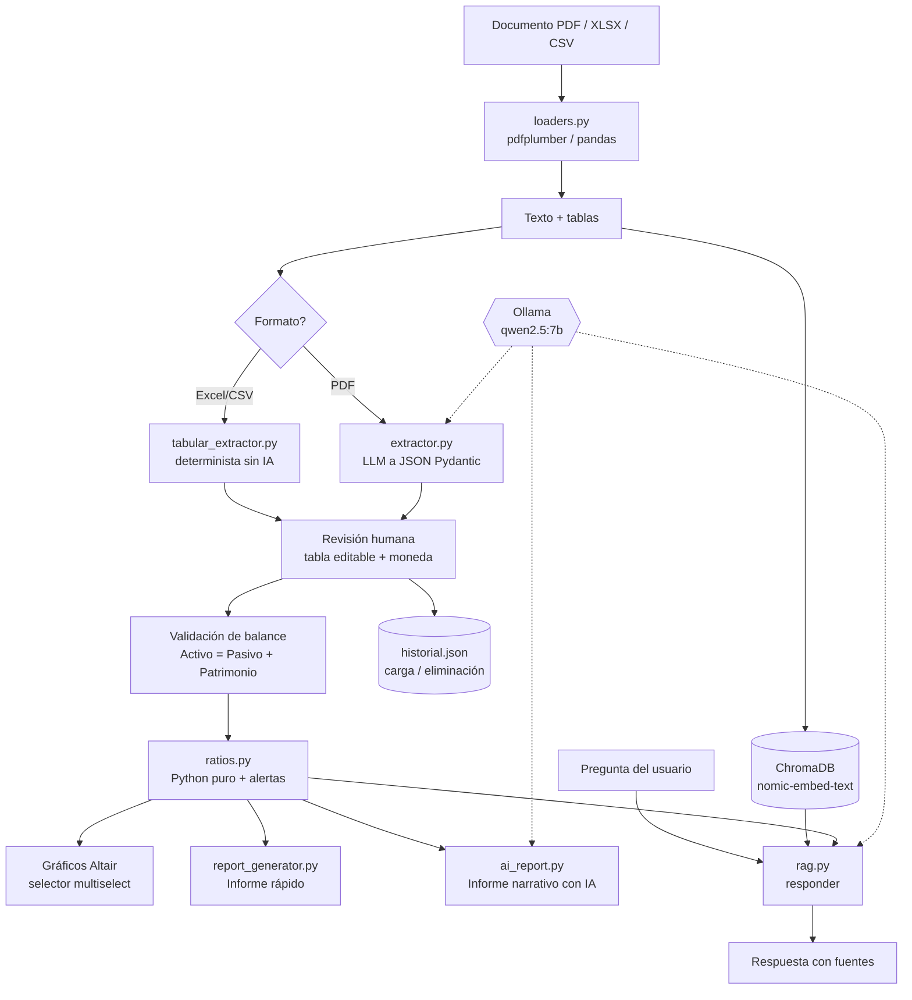
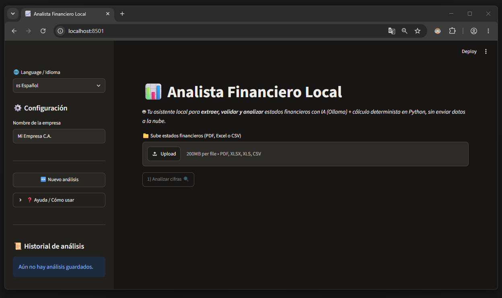
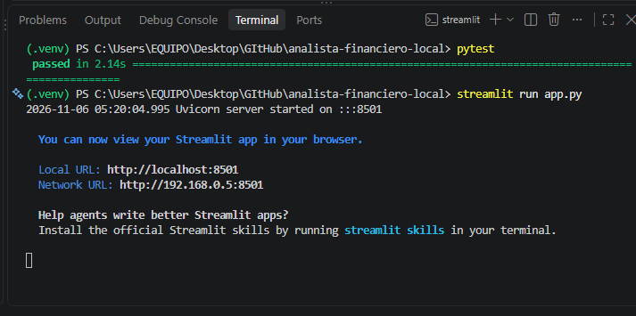
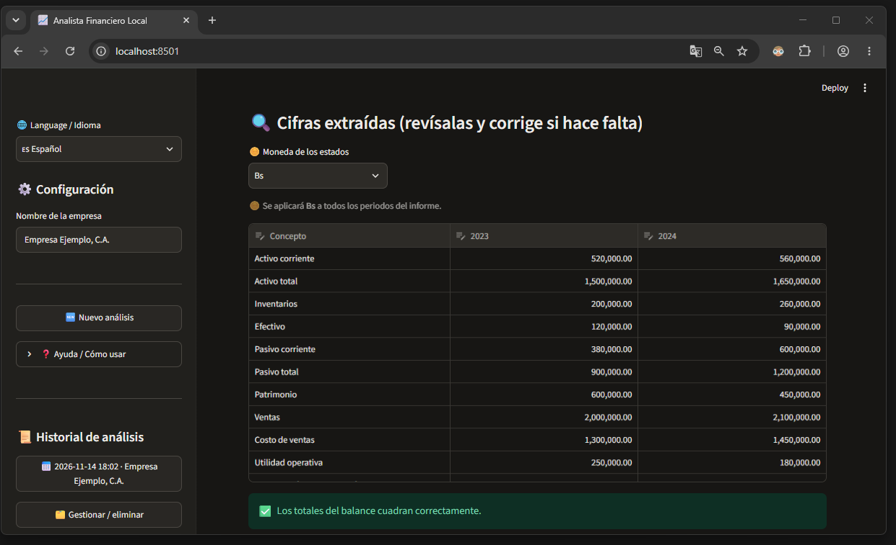
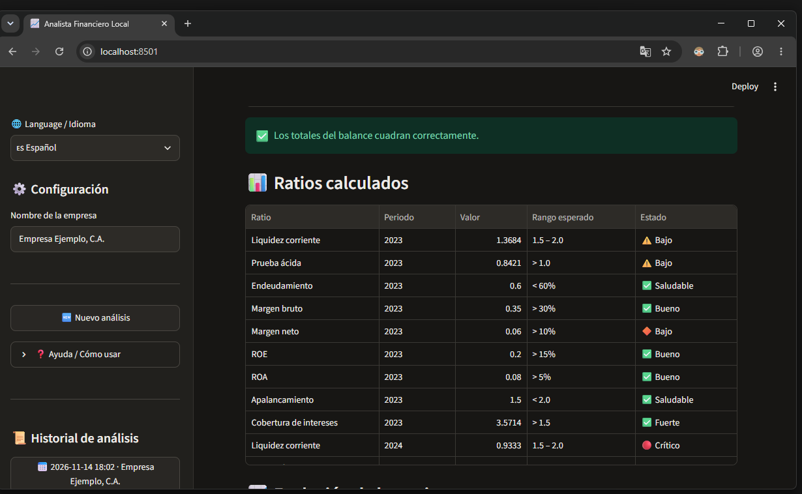
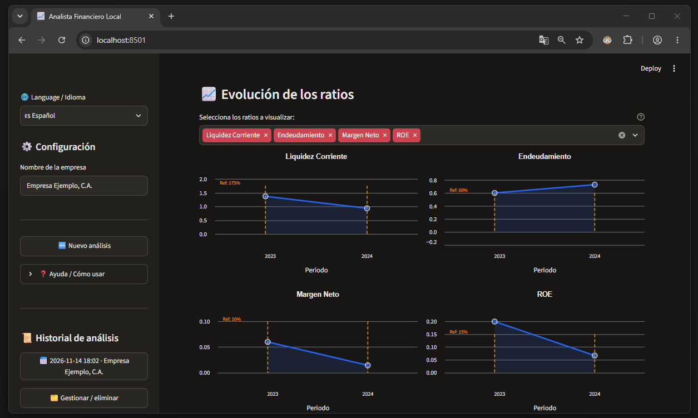
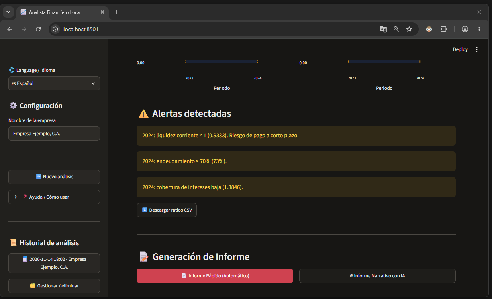
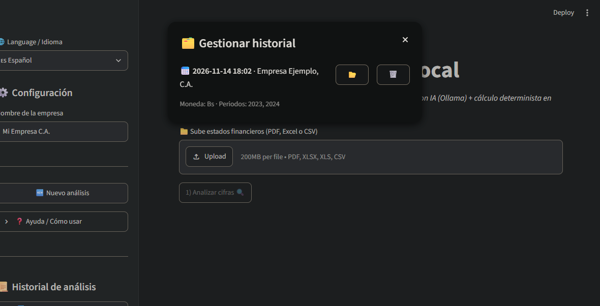
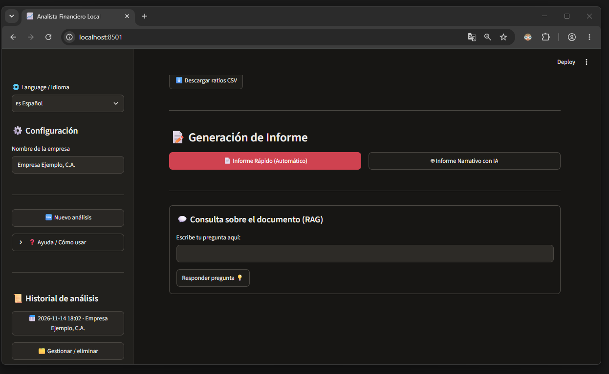
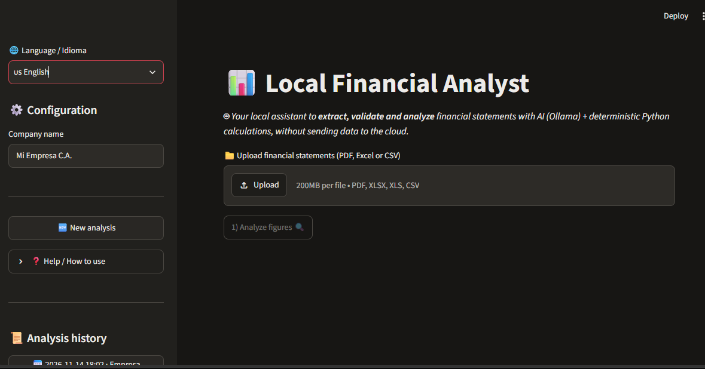

# Analista Financiero Local

Agente de IA **100 % local** que lee estados financieros en PDF, Excel o CSV, extrae las cifras con el método más adecuado según el formato, calcula ratios en Python puro, valida el balance contable y redacta informes.

El proyecto ofrece dos modalidades de informe:

- **Informe rápido:** instantáneo y basado en reglas de negocio.
- **Informe narrativo:** generado opcionalmente con IA local.

Está diseñado para ejecutarse en un equipo con **16 GB de RAM y sin GPU**.


## Índice

- [Por qué este proyecto](#por-qué-este-proyecto)
- [Qué hace](#qué-hace)
- [Ratios incluidos](#ratios-incluidos)
- [Arquitectura](#arquitectura)
- [Requisitos](#requisitos)
- [Instalación](#instalación)
- [Ejecutar con Docker](#ejecutar-con-docker)
- [Uso](#uso)
- [Pantallas](#pantallas)
- [Internacionalización](#internacionalización-es--en)
- [Historial persistente](#historial-persistente)
- [Preguntas sobre el documento (RAG)](#preguntas-sobre-el-documento-rag)
- [Datos de ejemplo](#datos-de-ejemplo)
- [Estructura del proyecto](#estructura-del-proyecto)
- [Configuración](#configuración-env)
- [Pruebas](#pruebas)
- [Límites y rendimiento](#límites-y-rendimiento-en-16-gb-sin-gpu)
- [Solución de problemas](#solución-de-problemas)
- [Próximos pasos](#próximos-pasos)
- [Capturas de pantalla](#capturas-de-pantalla)
- [Licencia](#licencia)

## Por qué este proyecto

La mayoría de los agentes Text-to-SQL se limitan al flujo «pregunta → consulta → tabla». Aquí el reto es diferente: los datos llegan desordenados dentro de un documento, por lo que primero hay que interpretarlos, verificarlos, calcularlos con reglas deterministas y explicar el resultado.

La regla de diseño que sostiene todo el proyecto es:

> **El LLM solo interviene donde hay ambigüedad. Python hace las cuentas y aplica las reglas.**

- **Excel y CSV:** extracción determinista mediante el mapeo de cuenta a campo, sin IA.
- **PDF:** extracción con LLM local porque el texto desestructurado puede ser ambiguo.
- **Ratios y alertas:** cálculo en Python puro, de forma reproducible y testeable.
- **Validación del balance:** comprobación de `Activo = Pasivo + Patrimonio`, con una tolerancia del 1 %.
- **Informes:** reglas de negocio para el informe rápido o IA narrativa de forma opcional.
- **RAG:** generación de respuestas con fuentes citadas.

El modelo no hace divisiones ni inventa ratios. Entrega un JSON validado con Pydantic; el usuario puede corregir la tabla en pantalla y `ratios.py` realiza la aritmética.

## Qué hace

1. Lee documentos PDF con `pdfplumber` y archivos Excel o CSV con `pandas`.
2. Procesa todas las hojas de los archivos Excel.
3. Indexa el texto en Chroma para realizar RAG local con `nomic-embed-text`.
4. Reemplaza el documento anterior al crear una nueva extracción.
5. Extrae las cifras según el formato:
   - **Excel y CSV:** `tabular_extractor.py`, mediante extracción determinista.
   - **PDF:** `extractor.py`, mediante `qwen2.5:7b` vía Ollama y JSON validado con Pydantic.
6. Valida el balance y bloquea el informe si `Activo ≠ Pasivo + Patrimonio`.
7. Muestra las cifras en una tabla editable con formato de moneda.
8. Calcula nueve ratios con rango esperado y estado visual: ✅, ⚠️ o 🔴.
9. Grafica la evolución de los ratios con Altair.
10. Genera informes en dos modalidades:
    - **Informe rápido:** reglas de negocio en Python e inmediata ejecución.
    - **Informe narrativo:** análisis contextual redactado por Ollama.
11. Responde preguntas sobre el documento mediante RAG y citas de fuente.
12. Guarda hasta 20 análisis en `historial.json`.
13. Traduce la interfaz completa al español o al inglés.

## Ratios incluidos

El sistema calcula los siguientes ratios:

- Liquidez corriente.
- Prueba ácida.
- Endeudamiento.
- Apalancamiento.
- Margen bruto.
- Margen neto.
- ROE.
- ROA.
- Cobertura de intereses.

Cada ratio incluye su **rango esperado** y un **estado** evaluado mediante reglas de negocio explicables.

### Alertas

Se generan alertas cuando se cumple alguna de estas condiciones:

- Liquidez corriente < 1.
- Endeudamiento > 70 %.
- Cobertura de intereses < 1,5.
- Pérdida neta.

## Arquitectura



> CrewAI fue eliminado. El informe narrativo utiliza Ollama directamente mediante `ai_report.py`, mientras que el informe rápido utiliza reglas de negocio puras mediante `report_generator.py`. Esto reduce el uso de IA a los procesos inherentemente ambiguos y acelera el flujo.

## Requisitos

| Requisito | Detalle |
|---|---|
| Python | 3.11 o superior |
| RAM | 16 GB. Con 8 GB, usar `LLM_MODEL=qwen2.5:3b` |
| GPU | No necesaria; se utilizan modelos cuantizados en CPU |
| Ollama | Instalado y ejecutándose en segundo plano |

## Instalación

### 1. Descargar los modelos locales

Ejecutar una sola vez:

```bash
ollama pull qwen2.5:7b
ollama pull nomic-embed-text
```

### 2. Crear el entorno Python

```bash
python -m venv .venv
source .venv/bin/activate
```

En Windows:

```powershell
.venv\Scripts\activate
```

Instalar las dependencias:

```bash
pip install -r requirements.txt
```

### 3. Configurar el entorno

```bash
cp .env.example .env
```

### 4. Ejecutar las pruebas y la aplicación

```bash
python -m pytest
streamlit run app.py
```

La aplicación estará disponible en <http://localhost:8501>.

> En Windows, si `pytest` falla con el mensaje «Directiva de Control de aplicaciones bloqueó este archivo», usar siempre `python -m pytest` en lugar de ejecutar `pytest` directamente.

## Ejecutar con Docker

Docker permite ejecutar la aplicación junto con Ollama sin instalar Python ni Ollama directamente en el sistema anfitrión.

### Requisitos

- Docker Desktop en Windows o macOS.
- Docker Engine y Compose en Linux.
- Al menos 10–12 GB de RAM asignados a Docker Desktop desde **Settings → Resources**.

### Arranque

```bash
git clone https://github.com/darwinjcn/analista-financiero-local-ia.git
cd analista-financiero-local-ia
docker compose up -d --build
```

La primera ejecución descarga aproximadamente 5 GB de modelos mediante `ollama-init`. Para seguir el progreso:

```bash
docker compose logs -f ollama-init
```

Cuando finalice, abrir <http://localhost:8501>.

### Comandos útiles

| Comando | Descripción |
|---|---|
| `docker compose logs -f app` | Ver los registros de la aplicación |
| `docker compose down` | Detener los contenedores; conserva los modelos |
| `docker compose down -v` | Detener y borrar los modelos y el índice RAG |
| `LLM_MODEL=qwen2.5:3b docker compose up -d` | Usar un modelo más liviano para equipos con 8 GB de RAM |

### Usar un Ollama ya instalado

Si Ollama ya está instalado en el equipo, se puede construir únicamente la aplicación y apuntarla a la instancia local:

```bash
docker build -t analista-financiero .
docker run -p 8501:8501 \
  -e OLLAMA_BASE_URL=http://host.docker.internal:11434 \
  analista-financiero
```

En Linux, añadir `--add-host=host.docker.internal:host-gateway` al comando `docker run`.

## Uso

1. Opcionalmente, cambiar el idioma desde el sidebar: **Español** o **English**.
2. Escribir el nombre de la empresa.
3. Subir un archivo PDF, XLSX, XLS o CSV.
4. Pulsar **Analizar cifras** 🔍.
   - Excel y CSV utilizan extracción determinista instantánea.
   - PDF utiliza Ollama y puede tardar más tiempo.
5. Seleccionar la moneda en el selector correspondiente 🪙.
6. Revisar y corregir la tabla de cifras, cuyo formato es similar a `1,500,000.00`.
7. Corregir los valores si la validación del balance indica que no cuadra.
8. Revisar la tabla de ratios, sus rangos esperados y sus estados.
9. Seleccionar los ratios que se mostrarán en **Evolución de los ratios**.
10. Consultar las alertas y descargar el CSV si es necesario.
11. Generar el informe:
    - **Informe rápido:** instantáneo y basado en reglas de negocio.
    - **Informe narrativo con IA:** análisis contextual generado por Ollama.
12. Escribir una pregunta en el campo de RAG y pulsar **Responder pregunta** 💡.
13. Abrir **Ver fuentes** 📚 para contrastar la evidencia.
14. Usar **Nuevo análisis** 🆕 para limpiar la sesión o cargar un análisis anterior desde **Historial** 📜.

## Pantallas

### 1. Pantalla principal

Sidebar completo con idioma, empresa, ayuda e historial.



### 2. Pruebas y arranque desde la terminal

Ejecución de `pytest` y arranque de Streamlit desde VS Code.



### 3. Cifras extraídas

Tabla editable vertical con formato de moneda.



### 4. Ratios calculados

Tabla de ratios con rango esperado y estado visual.



### 5. Evolución de los ratios

Gráficos Altair con selector múltiple, área sombreada, línea de referencia y puntos interactivos.



### 6. Alertas e informes

Alertas detectadas y botones para generar el informe rápido o el informe narrativo con IA.



### 7. Gestión del historial

Diálogo modal con opciones para cargar y eliminar análisis.



### 8. Consulta RAG con fuentes

Formulario de preguntas, respuesta generada y fuentes utilizadas.



### 9. Interfaz en inglés

La interfaz puede cambiarse a inglés desde el selector de idioma del sidebar.




## Internacionalización (ES / EN)

El selector **Language / Idioma** 🌐 se encuentra en la parte superior del sidebar.

La traducción cubre:

- Títulos y botones.
- Indicadores de carga.
- Tablas y encabezados.
- Estados de los ratios.
- Diálogo del historial.
- Sección de ayuda.
- Nombres de las cuentas en la tabla de cifras.

El idioma no afecta a la extracción. El extractor determinista acepta cuentas en español e inglés mediante el mapa bilingüe de `tabular_extractor.py`.

## Historial persistente

Cada análisis se guarda automáticamente en `historial.json`, con un máximo de 20 entradas. Cada entrada muestra en el sidebar la fecha, la empresa y la moneda.

Al seleccionar una entrada, se recargan las cifras en la tabla editable. La opción **Gestionar / eliminar** abre un diálogo modal con:

- **Cargar análisis** 📂.
- **Eliminar con confirmación explícita** 🗑️.

El archivo `historial.json` está incluido en `.gitignore` para evitar publicar datos locales del usuario.

## Preguntas sobre el documento (RAG)

La búsqueda recupera hasta cuatro fragmentos del último documento extraído. Cada nueva extracción reemplaza la colección anterior de Chroma; no existe un historial multidocumento.

`qwen2.5:7b` recibe los fragmentos recuperados, la pregunta del usuario y la tabla de ratios calculados en Python a partir de las cifras revisadas. Se le solicita responder con citas como `[ejemplo_estados.csv #0]` o `[Ratios calculados]` y decir «No aparece en el documento» cuando no encuentra evidencia.

La opción **Ver fuentes** muestra los fragmentos utilizados y la tabla de ratios. El identificador `#0` corresponde al fragmento recuperado y no necesariamente a una página del PDF.

Al cambiar el archivo se descartan las cifras y la respuesta anteriores; es necesario volver a extraer el documento. Corregir la tabla también oculta la respuesta anterior hasta realizar una nueva consulta.

Ejemplos de preguntas:

- «¿Cuál es el activo corriente de 2024?»
- «Interpreta la liquidez corriente de ambos periodos».
- «¿Las notas explican el endeudamiento de 2024?».

El tiempo de respuesta depende de la CPU, el contexto y el modelo: puede variar entre decenas de segundos y varios minutos.

> **Limitación importante:** las citas y la abstención son instrucciones para el modelo, no una garantía de exactitud. La búsqueda puede omitir información relevante. Contrasta cada respuesta con el documento y los ratios; este asistente no sustituye una auditoría.

Esta versión mantiene un único documento activo por carpeta definida en `CHROMA_DIR` y está pensada para uso local individual. No ejecutes varias sesiones con documentos distintos sobre la misma carpeta de índice.

## Datos de ejemplo

Los tres archivos de `data/` contienen las mismas cifras en formatos diferentes para comparar la extracción entre PDF, Excel y CSV. El periodo 2024 está construido intencionadamente para activar varias alertas: liquidez inferior a 1, endeudamiento superior al 70 % y cobertura de intereses baja.

| Archivo | Para probar |
|---|---|
| `data/ejemplo_estados.csv` | Extracción determinista; ruta más simple |
| `data/ejemplo_estados.xlsx` | Extracción determinista con `openpyxl` y soporte multihoja |
| `data/ejemplo_estados.pdf` | Extracción con LLM vía `pdfplumber`, usando texto y tablas |

Los datos son sintéticos y no corresponden a ninguna empresa real.

Para probar con información propia, deja el archivo en `data/` o súbelo desde la aplicación. `.gitignore` excluye los archivos cuyo nombre no empieza por `ejemplo_` para evitar que se suban por accidente.

## Estructura del proyecto

```text
analista-financiero-local/
├── app.py                      # Pantalla Streamlit y flujo completo
├── requirements.txt
├── .env.example                # Plantilla de configuración
├── data/
│   ├── ejemplo_estados.csv
│   ├── ejemplo_estados.xlsx
│   └── ejemplo_estados.pdf
├── src/
│   ├── config.py               # Variables de entorno
│   ├── loaders.py              # PDF / Excel multihoja / CSV → texto
│   ├── schemas.py              # Contrato Pydantic de las cifras
│   ├── extractor.py            # LLM → JSON validado; solo PDF
│   ├── tabular_extractor.py    # Extracción determinista y bilingüe
│   ├── ratios.py               # Ratios y alertas en Python puro
│   ├── rag.py                  # Indexado, búsqueda y respuestas locales
│   ├── report_generator.py     # Informe rápido con reglas de negocio
│   ├── ai_report.py            # Informe narrativo con Ollama
│   └── i18n.py                 # Traducciones ES / EN
├── tests/
│   ├── test_ratios.py          # Cálculos y alertas
│   ├── test_periodos.py        # Validación de periodos
│   ├── test_rag.py             # Fuentes, ratios y reemplazo de documentos
│   └── test_app_rag.py         # Flujo de preguntas en Streamlit
├── docs/
│   └── screenshots/            # Capturas utilizadas en este README
├── Dockerfile
├── docker-compose.yml
├── .dockerignore
├── LICENSE                     # Licencia MIT
└── pytest.ini                  # Configuración de pytest
```

## Configuración (`.env`)

| Variable | Valor por defecto | Descripción |
|---|---|---|
| `OLLAMA_BASE_URL` | `http://localhost:11434` | Dirección de Ollama |
| `LLM_MODEL` | `qwen2.5:7b` | Modelo utilizado para extracción y generación |
| `EMBED_MODEL` | `nomic-embed-text` | Modelo de embeddings del RAG |
| `NUM_CTX` | `8192` | Ventana de contexto; reducirla si falta RAM |
| `CHROMA_DIR` | `./chroma_db` | Carpeta donde se guarda el índice |

## Pruebas

Ejecutar:

```bash
python -m pytest -v
```

Las pruebas cubren:

- Cálculo de ratios.
- Reglas de alerta.
- Validación de periodos.
- Reemplazo real de la colección Chroma con embeddings simulados.
- Construcción de consultas RAG con un modelo simulado.
- Flujo de preguntas y fuentes en Streamlit.

No se valida la calidad de las respuestas generadas por Ollama. La extracción con LLM depende del modelo y debe contrastarse manualmente con las cifras conocidas de `data/`. La extracción determinista de Excel y CSV es reproducible y testeable sin IA.

## Límites y rendimiento en 16 GB sin GPU

- Se recomienda ejecutar un solo modelo de 7–8B a la vez. Con modelos de 14B o más, la CPU puede volverse muy lenta.
- Mantener `NUM_CTX` entre 4096 y 8192. Un contexto mayor consume más RAM.
- La extracción con LLM procesa hasta 12 000 caracteres del documento (`max_chars` en `extractor.py`). Para documentos largos, se recomienda indexar por secciones.
- Excel y CSV no utilizan IA: su extracción determinista es instantánea y no consume RAM del modelo.
- El informe rápido se genera al instante. El informe narrativo puede tardar varios minutos en CPU.

## Solución de problemas

| Síntoma | Causa probable | Solución |
|---|---|---|
| `Connection error` al extraer | Ollama no está ejecutándose | Abrir Ollama y verificar con `curl http://localhost:11434` |
| Tarda mucho o consume toda la RAM | Contexto demasiado grande | Usar `NUM_CTX=4096` o `LLM_MODEL=qwen2.5:3b` |
| El JSON llega mal formado | Documento muy desordenado | Revisar y corregir la tabla editable manualmente |
| El PDF no entrega texto | PDF escaneado como imagen | Se necesita OCR; `pdfplumber` solo lee texto real |
| Excel no carga | Faltan motores de lectura | Ejecutar `pip install openpyxl xlrd` |
| `pytest.exe` está bloqueado en Windows | Smart App Control | Usar `python -m pytest` |
| Un campo crítico aparece como `None` en PDF | El LLM omitió una celda | Corregir la tabla o probar con `qwen2.5:14b` |
| El historial no se refresca al instante | Renderizado del sidebar en Streamlit | Recargar la página con `R` |

## Próximos pasos

- Añadir análisis horizontal y vertical.
- Incorporar comparación con benchmarks del sector.
- Exportar informes a PDF o Word.
- Crear un conjunto de evaluación con documentos de cifras conocidas para medir la precisión de la extracción.
- Añadir OCR para PDFs escaneados.
- Detectar automáticamente la moneda a partir de las notas del documento.

## Capturas de pantalla

Las imágenes utilizadas al principio de este README se encuentran en `docs/screenshots/`. Si actualizas la interfaz, reemplaza el archivo correspondiente manteniendo su nombre:

```text
docs/screenshots/
├── 01-pantalla-principal.png
├── 02-terminal-pruebas-y-arranque.png
├── 03-cifras-extraidas.png
├── 04-ratios-calculados.png
├── 05-evolucion-ratios.png
├── 06-alertas-e-informe.png
├── 07-gestion-historial.png
├── 08-consulta-rag.png
└── 09-version-ingles.png
```

## Licencia

El proyecto se distribuye bajo la licencia MIT. Consulta el archivo `LICENSE` para conocer los términos completos.

Puedes usar, copiar, modificar y distribuir el código, incluso con fines comerciales, siempre que mantengas el aviso de copyright y la licencia.

Los archivos `data/ejemplo_*` contienen datos sintéticos y no representan a ninguna empresa real.
